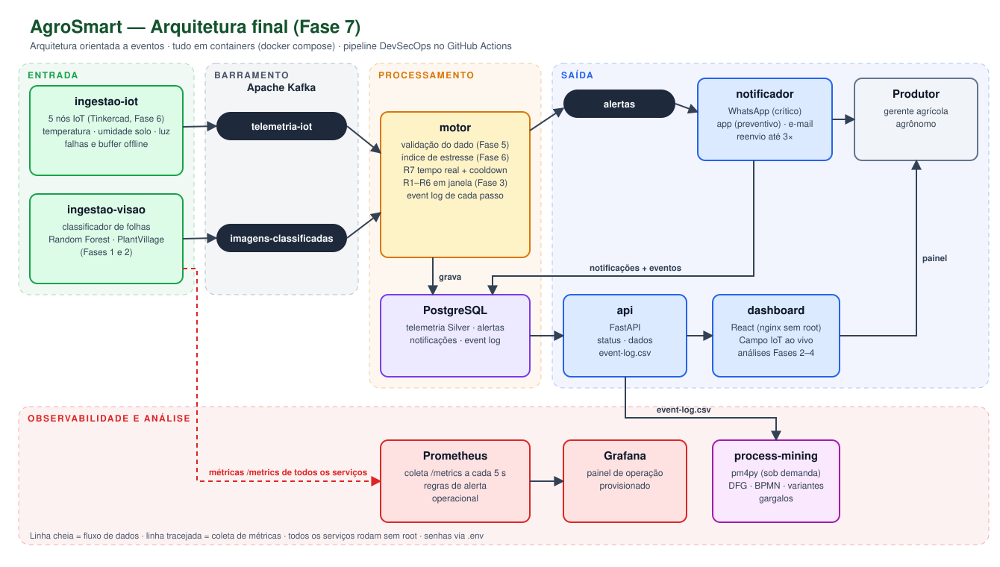
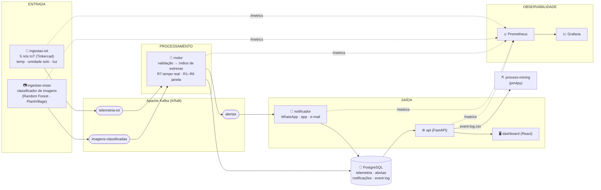
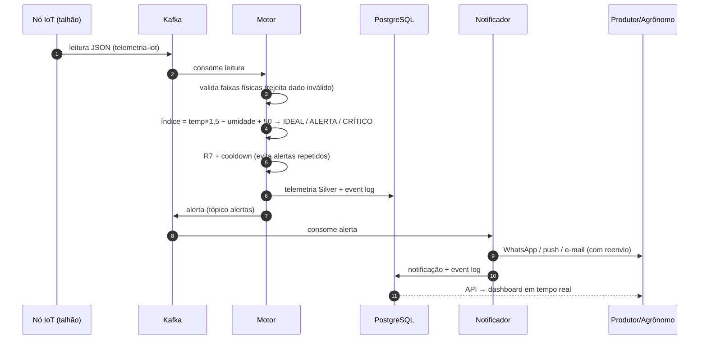

# 1. Arquitetura Final da Solução

## 1.1 Visão geral

O AgroSmart é uma arquitetura **orientada a eventos**: cada parte do sistema publica o que
aconteceu em um barramento (Apache Kafka) e as demais reagem a isso. Os serviços ficam
desacoplados. O sensor não sabe quem vai ler o dado, e o notificador não sabe de onde veio o alerta.
Assim, cada parte pode evoluir, escalar ou falhar sem derrubar as outras.

## 1.2 Componentes do sistema

| # | Componente | Tecnologia | Responsabilidade | Origem |
|---|---|---|---|---|
| 1 | **ingestao-iot** | Python | Simula 5 nós IoT (um por talhão) com ciclo dia/noite, secagem do solo e irrigação. Publica o payload JSON da Fase 6 a cada 3 s. Simula falhas reais: sensor com defeito e perda de conexão (o nó guarda as leituras em buffer e reenvia quando volta). | Fase 6 |
| 2 | **ingestao-visao** | Python | Publica eventos de classificação de folhas amostrados do CSV **real** gerado pelo classificador Random Forest. A cada ~40 s uma região entra "em surto". | Fases 1, 2 e 4 |
| 3 | **broker** | Apache Kafka 3.9 (KRaft) | Barramento de eventos. Tópicos: `telemetria-iot`, `imagens-classificadas`, `alertas`. | Fase 4 |
| 4 | **motor** | Python | Cérebro da plataforma. **Telemetria:** valida o dado → calcula o índice de estresse hídrico → aplica a regra **R7** com controle de *cooldown*. **Imagens:** mantém uma janela das últimas 500 classificações e reavalia as regras **R1–R6** a cada 5 s. Grava tudo no banco, publica alertas e registra o event log. | Fases 3, 4, 5 e 6 |
| 5 | **notificador** | Python | Consome `alertas` e envia pelo canal adequado: WhatsApp (crítico), push no app (preventivo), e-mail (sanidade). Respeita o tempo de resposta de cada gateway e reenvia até 3 vezes em caso de falha. | Novo (BMC da Fase 4) |
| 6 | **postgres** | PostgreSQL 16 | Armazena a telemetria tratada (camada Silver), classificações, ciclos de regras, alertas, notificações e o **event log**. | Fase 4 |
| 7 | **api** | FastAPI | Camada de leitura: dados para o dashboard, status operacional, exportação do event log e métricas. Documentação automática em `/docs`. | Fase 4 |
| 8 | **dashboard** | React + Recharts (nginx sem root) | Painel do produtor. Aba **Campo IoT** ao vivo (talhões, índice de estresse, notificações, status da plataforma) + abas analíticas das Fases 2–4. | Fases 2, 3 e 4 |
| 9 | **prometheus** | Prometheus 2.55 | Coleta métricas de todos os serviços a cada 5 s e avalia regras de alerta operacional. | Novo |
| 10 | **grafana** | Grafana 11 | Painel de operação pronto (provisionado automaticamente). | Novo |
| 11 | **process-mining** | Python + pm4py | Executado sob demanda: lê o event log e gera mapas do processo, variantes, gargalos e o relatório de análise. | Novo |

### Regras de decisão

| Regra | Fluxo | Condição (resumo) | Ação |
|---|---|---|---|
| R1 | Imagens | % de doentes na região > 30% | Alerta ALTA/CRÍTICA, plano de contenção |
| R2 | Imagens | % de doentes na cultura > 40% ou doença dominante > 25% | Tratamento direcionado |
| R3 | Imagens | Mesma doença ≥ 3 vezes no mês | Alerta de surto sazonal |
| R4 | Imagens | Confiança média < 75% e erro > 15% | Reavaliar/retreinar modelo |
| R5 | Imagens | Região com < 10% de doentes e acurácia > 85% | Recomendação de manutenção |
| R6 | Imagens | % de doentes do mês > 1,5× o mês anterior | Alerta de tendência de piora |
| **R7** | **IoT** | Índice de estresse > 40 (ALERTA) ou > 60 (CRÍTICO) | **Irrigar já (WhatsApp ao gerente) / inspecionar em 24 h (app do agrônomo)** |

Índice de estresse hídrico (Fase 6): `temperatura × 1,5 − umidade do solo + 50`.

## 1.3 Fluxo de dados completo

### Entrada → processamento → saída (telemetria IoT)

1. **Entrada.** Cada nó IoT lê temperatura (TMP36), luminosidade (LDR) e umidade do solo e publica
   no tópico `telemetria-iot`. O payload é o mesmo do protótipo Tinkercad da Fase 6
   (`device_id`, `temperatura_c`, `luminosidade_pct`, `umidade_solo_pct`) mais `leitura_id` e `ts_coleta`.
   Em paralelo, o classificador publica em `imagens-classificadas`.
2. **Processamento.** O motor consome os dois tópicos:
   - leitura IoT: **validação** (governança da Fase 5: dado fora da faixa é rejeitado com motivo) →
     **enriquecimento** (índice de estresse e status do solo) → **decisão R7**;
   - classificações: entram numa **janela deslizante**; a cada 5 s as regras R1–R6 são reavaliadas.
3. **Persistência.** A leitura tratada (camada Silver), os ciclos e os alertas vão para o PostgreSQL.
   Cada passo de cada leitura vira um evento no **event log**.
4. **Automação.** Alertas que exigem ação são publicados no tópico `alertas`. O notificador
   envia pelo canal certo, com reenvio automático.
5. **Saída.** O dashboard consulta a API a cada 3 s (talhões ao vivo, alertas, notificações e status).
   O Grafana mostra a saúde da operação. O event log alimenta a mineração de processos.

## 1.4 Decisões de arquitetura

| Decisão | Por quê |
|---|---|
| Kafka como barramento | Desacopla entrada e processamento. Se o motor parar, as leituras ficam guardadas no tópico e são processadas quando ele voltar. |
| Regras R1–R6 reaproveitadas sem alteração | A lógica validada na Fase 3 é a mesma no batch e no streaming, sem retrabalho e sem risco de divergência. |
| R7 com *cooldown* por talhão | Sem ele, um talhão em ALERTA geraria uma mensagem a cada 3 s. Isso causa fadiga de alerta e o produtor passa a ignorar o sistema. |
| Event log gravado pela própria plataforma | O processo é medido como realmente acontece (não como foi desenhado), base para a mineração de processos. |
| Uma imagem Docker para todos os serviços Python | Menos superfície de ataque e manutenção mais simples. Todas rodam **sem root**. |
| Configuração por variáveis de ambiente (`.env`) | Nenhuma senha no código; o mesmo artefato roda em qualquer ambiente. |
