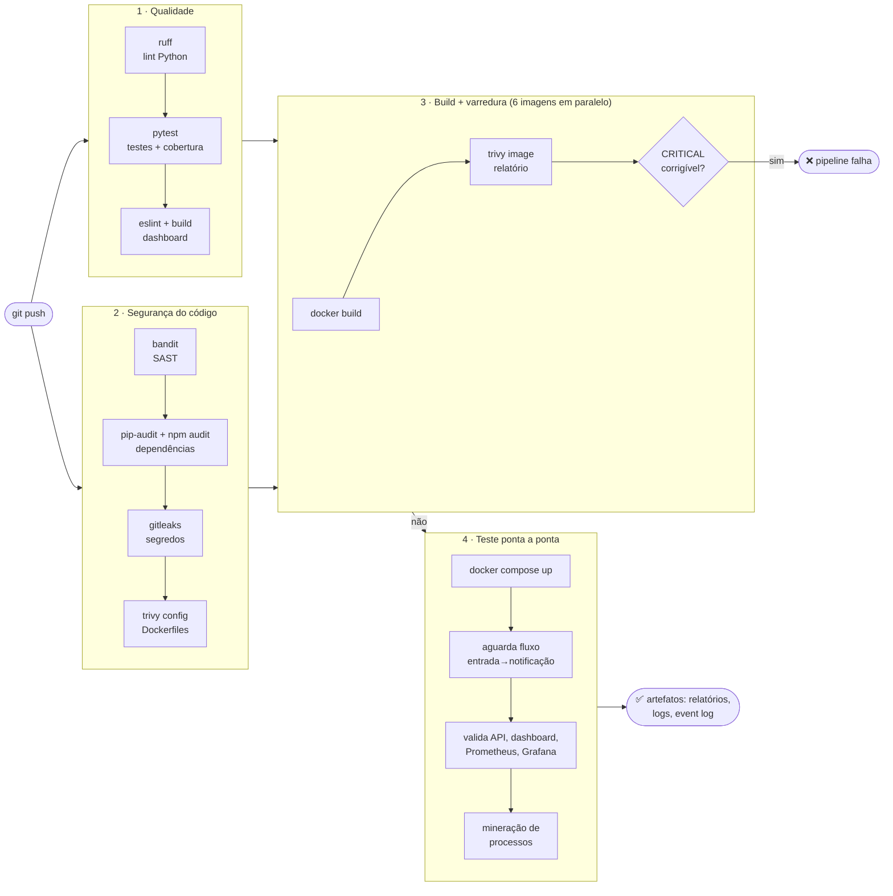

# 3. Pipeline DevSecOps da Solução

## 3.1 Visão geral

Todo `push` na branch `main` (e todo pull request) dispara automaticamente o pipeline
[`.github/workflows/devsecops.yml`](../.github/workflows/devsecops.yml) no **GitHub Actions**.
A segurança não fica para o fim: ela é verificada em cada etapa, e o código só avança se passar
(*shift-left security*).



## 3.2 Etapas implementadas

| Job | Etapa | Ferramenta | O que garante | Quebra o pipeline se… |
|---|---|---|---|---|
| **1 · Qualidade** | Lint Python | **ruff** (regras de estilo, bugs comuns, imports, segurança `S`) | Código limpo e padronizado | houver qualquer violação |
| | Testes unitários | **pytest** + **pytest-cov** (25 testes) | Regras R1–R7, fórmula do índice, validação, cooldown e logs funcionam | algum teste falhar |
| | Lint + build front-end | **eslint** + **vite build** | Dashboard compila e segue as boas práticas do React | houver erro de lint ou build |
| **2 · Segurança** | SAST | **bandit** | Sem padrões inseguros (SQL injection, `eval`, senhas fixas...) | houver achado de severidade média ou alta |
| | Dependências Python | **pip-audit** (base OSV/PyPI) | Nenhuma biblioteca com CVE conhecida | houver vulnerabilidade conhecida |
| | Dependências JS | **npm audit** | Idem para o dashboard | houver vulnerabilidade alta ou crítica |
| | Segredos | **gitleaks** (todo o histórico do Git) | Nenhuma senha/token/chave no repositório | encontrar um segredo |
| | Infraestrutura como código | **trivy config** | Dockerfiles seguem boas práticas (ex.: não rodar como root) | houver falha alta ou crítica |
| **3 · Build** | Build das imagens | **docker build** (matriz com 6 serviços) | Todas as imagens constroem | o build falhar |
| | Vulnerabilidades das imagens | **trivy image** | Sistema operacional e bibliotecas das imagens sem CVE crítica | houver CVE **CRÍTICA com correção disponível** (*security gate*) |
| **4 · Integração** | Execução via container | **docker compose** | A plataforma inteira sobe e funciona ponta a ponta | o fluxo entrada → notificação não completar em 5 min |
| | Verificação | curl + asserts | API, dashboard, Prometheus (todos os alvos *up*) e Grafana respondem | algum componente não responder |
| | Process mining | pm4py | O event log gerado é analisável | a análise falhar |

Os resultados do **bandit** e do **trivy** também são publicados na aba **Security** do GitHub
(formato SARIF). Relatórios de testes, cobertura, logs e a análise de processo ficam como
**artefatos** de cada execução.

## 3.3 Práticas de segurança aplicadas no código e nos containers

| Prática | Onde |
|---|---|
| Todos os containers da aplicação rodam **sem root** (usuário `agrosmart` uid 10001; nginx como `nginx`) | `services/Dockerfile.python`, `services/dashboard/Dockerfile` |
| Senhas **fora do código**: variáveis de ambiente via `.env` (no `.gitignore`); `.env.example` documenta o formato | `docker-compose.yml`, `.env.example` |
| Imagens base mínimas (`python:3.12-slim`, `alpine`) com pacotes atualizados no build | Dockerfiles |
| Cabeçalhos de segurança HTTP no dashboard (`X-Frame-Options`, `X-Content-Type-Options`, `Referrer-Policy`) e versão do servidor oculta | `services/dashboard/nginx.conf` |
| Consultas SQL sempre parametrizadas (`%s`) — nada de concatenar entrada do usuário | `services/comum/db.py`, `services/api/main.py` |
| Validação de entrada da API (limites em parâmetros com `Query(ge=, le=)`) | `services/api/main.py` |
| Banco de dados **não exposto** para fora da rede do compose | `docker-compose.yml` |
| Exceções de scanner só com **justificativa documentada** | `.trivyignore` |

## 3.4 Problemas reais que o pipeline encontrou (e como foram corrigidos)

A primeira varredura local, antes do primeiro push, já encontrou problemas reais. No GitHub, a primeira execução também falhou: a versão `0.28.0` da `aquasecurity/trivy-action` não existia mais. A correção foi rodar o Trivy direto pela imagem oficial, com versão fixada, sem depender de action de terceiros. É exatamente
para isso que serve o *security gate*:

| Achado | Ferramenta | Correção |
|---|---|---|
| Imagem oficial `nginx-unprivileged:1.27-alpine` com **3 CVEs críticas** (OpenSSL) e dezenas de altas | trivy image | Dashboard migrado para `alpine:3.24` + nginx do repositório Alpine + `apk upgrade` → **0 críticas, 0 altas** |
| Dockerfile do dashboard sem `USER` explícito | trivy config (AVD-DS-0002) | `USER nginx` declarado |
| `try/except/pass` silencioso no notificador | ruff (S110) / bandit (B110) | Exceção passa a ser registrada em log |
| Variável não utilizada no código herdado do dashboard (Fase 4) | eslint | Corrigido |
| `setuptools 70.3.0` (CVE-2025-47273) apontado nas imagens Python | trivy image | Investigado: **falso positivo** (só aparece no SBOM embutido do pacote do Kafka, não está instalado). Registrado com justificativa em `.trivyignore` |

## 3.5 Evidência da execução

- Execução de referência (todos os jobs verdes): https://github.com/EnzoOC/fase_7_challenge/actions/runs/45508862424
- Prints: `evidencias/04_pipeline_visao_geral.png`, `evidencias/05_pipeline_seguranca.png`,
  `evidencias/06_pipeline_integracao.png`
- Artefatos baixáveis em cada execução: `relatorios-qualidade` (cobertura e testes) e
  `evidencias-execucao` (logs dos serviços, status, event log e relatório de processo)

## 3.6 Rodando as mesmas verificações localmente

```bash
pip install -r requirements-dev.txt -r services/motor/requirements.txt -r services/api/requirements.txt
ruff check .
pytest --cov
bandit -c pyproject.toml -r services process_mining
for r in services/*/requirements.txt; do pip-audit -r $r; done
(cd services/dashboard && npm ci && npx eslint . && npm audit --omit=dev)
docker run --rm -v "$PWD:/repo" ghcr.io/gitleaks/gitleaks:v8.21.2 detect --source /repo
docker run --rm -v "$PWD:/repo" aquasec/trivy config /repo
```
