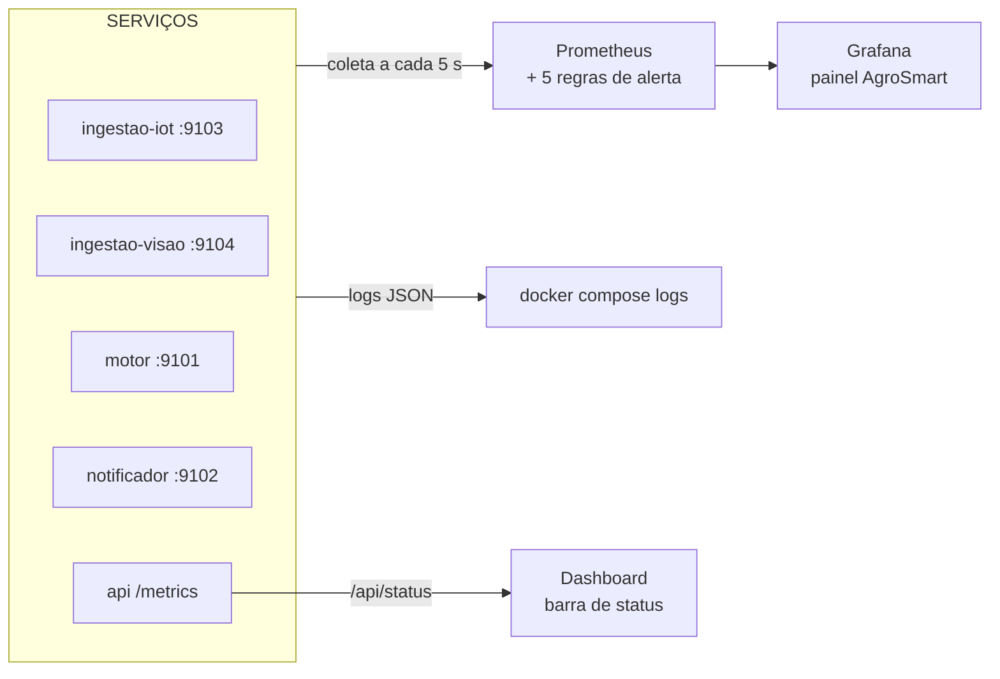

# 4. Monitoramento e Execução Automatizada

## 4.1 Execução contínua

A plataforma foi feita para rodar **sem intervenção humana**:

| Mecanismo | Como funciona |
|---|---|
| Subida automática e ordenada | `docker compose up -d` sobe os 10 serviços. O motor e o notificador só iniciam depois que o Kafka e o PostgreSQL passam no *healthcheck* (`depends_on: condition: service_healthy`). |
| Auto-recuperação | Todos os serviços têm `restart: unless-stopped`: se um processo cair, o container é reiniciado automaticamente. |
| Tolerância a falhas | Os serviços esperam o Kafka/PostgreSQL com *retry*. Se o motor parar, as leituras ficam guardadas no tópico Kafka e são processadas quando ele voltar. Uma mensagem malformada é registrada em log e não derruba o motor. |
| Healthchecks | Kafka, PostgreSQL e API têm *healthcheck* próprio (`docker compose ps` mostra `healthy`). |
| Automação no ciclo de vida | O pipeline do GitHub Actions sobe a plataforma inteira a cada `push` e verifica que ela funciona ponta a ponta. |

## 4.2 Os três níveis de monitoramento



### 1) Métricas (Prometheus + Grafana)

Cada serviço expõe um endpoint `/metrics`. O Prometheus coleta as métricas a cada 5 segundos e
o Grafana já sobe com o painel **"AgroSmart — Operação da Plataforma"** configurado
(não é preciso montar nada à mão).

| Métrica | O que indica |
|---|---|
| `up{job=...}` | Se cada serviço está no ar (1) ou fora (0) |
| `agrosmart_motor_leituras_total{resultado}` | Leituras válidas × rejeitadas → taxa de leituras por minuto e % de dados ruins |
| `agrosmart_motor_status_solo_total{status}` | Quantas leituras IDEAL / ALERTA / CRÍTICO |
| `agrosmart_motor_alertas_total{regra,severidade}` | Alertas emitidos por regra (R1–R7) |
| `agrosmart_motor_alertas_suprimidos_total` | Alertas evitados pelo *cooldown* |
| `agrosmart_indice_estresse{talhao}` · `agrosmart_umidade_solo_pct` · `agrosmart_temperatura_c` | Situação de cada talhão em tempo real |
| `agrosmart_motor_latencia_ingestao_seconds` | Tempo entre a coleta no sensor e a decisão no motor (p50/p95) |
| `agrosmart_notificador_fila` · `agrosmart_notificacao_espera_seconds` | Tamanho da fila e tempo de espera das notificações |
| `agrosmart_notificacoes_total{canal,resultado}` · `..._falhas_tentativa_total` | Envios por canal, falhas e reenvios |
| `agrosmart_iot_device_offline{device_id}` · `agrosmart_iot_buffer_leituras` | Nós sem conexão e leituras guardadas em buffer |
| `agrosmart_api_requisicoes_total` · `agrosmart_api_latencia_seconds` | Uso e desempenho da API |

**Painel do Grafana** (http://localhost:3000):

| Seção | Painéis |
|---|---|
| Saúde da plataforma | Status de cada serviço (NO AR / FORA) · leituras/min · % rejeitadas · fila de notificações · nós offline |
| Campo — tempo real | Índice de estresse por talhão (com faixas de ALERTA e CRÍTICO) · umidade do solo · temperatura |
| Decisões automatizadas | Leituras por status do solo · alertas por regra · alertas suprimidos · alertas ativos R1–R6 |
| Desempenho do processo | Latência coleta → decisão (p50/p95) · espera na fila de notificação · notificações por canal · API |

**Regras de alerta operacional** (Prometheus, http://localhost:9090/alerts):

| Alerta | Dispara quando | Severidade |
|---|---|---|
| `ServicoFora` | Algum serviço não responde há 30 s | crítica |
| `MotorParado` | O motor não processa nenhum evento há 1 min | crítica |
| `TaxaRejeicaoAlta` | Mais de 10% das leituras rejeitadas por 2 min (sensor com defeito) | alta |
| `FilaNotificacaoAlta` | Mais de 10 alertas esperando envio por 1 min | alta |
| `DispositivoOffline` | Um nó IoT está sem conexão há 30 s | média |

> Note a diferença entre os dois tipos de alerta: os alertas **agronômicos** (R1–R7) avisam o
> produtor sobre a **lavoura**; os alertas **operacionais** avisam a equipe técnica sobre a
> **plataforma**.

### 2) Logs estruturados

Todos os serviços escrevem **uma linha JSON por evento**, com horário, nível, serviço e contexto:

```json
{"ts": "2026-11-24T21:58:34.753+00:00", "nivel": "WARNING", "servico": "notificador", "msg": "falha no envio — reenviando", "case_id": "TINKER-TALHAO-01-11242155-00054", "canal": "whatsapp", "tentativa": 1}
{"ts": "2026-11-24T21:50:39.927+00:00", "nivel": "WARNING", "servico": "motor", "msg": "leitura rejeitada", "leitura_id": "TINKER-TALHAO-05-11242150-00006", "motivo": "luminosidade_pct fora da faixa (999.0)"}
{"ts": "2026-11-24T21:59:43.863+00:00", "nivel": "INFO", "servico": "ingestao-iot", "msg": "nó reconectado — buffer reenviado", "device_id": "TINKER-TALHAO-01", "leituras": 12}
```

Isso permite filtrar por máquina sem precisar de ferramentas extras:

```bash
docker compose logs -f motor                                  # acompanhar ao vivo
docker compose logs motor | grep '"nivel": "WARNING"'         # só avisos
docker compose logs notificador | grep '"canal": "whatsapp"'  # só WhatsApp
```

O mesmo formato pode ser enviado sem mudanças para Loki, ELK ou CloudWatch numa evolução para produção.

### 3) Status de execução (API e dashboard)

`GET /api/status` mede o **frescor** de cada etapa do pipeline. Se uma etapa para de produzir
dados, o status muda para `degradado`:

```json
{
  "status": "operacional",
  "etapas": {"ingestao_iot_motor": "ok", "regras_r1_r6": "ok", "notificador": "ok"},
  "dispositivos_ativos": 5,
  "leituras_ultimo_min": 97,
  "rejeitadas_10min": 30
}
```

Esse status aparece na barra superior da aba **Campo IoT** do dashboard. Assim, o próprio
produtor vê se a plataforma está funcionando, sem precisar abrir o Grafana.

## 4.3 Como acompanhar o sistema (roteiro de operação)

| Pergunta | Onde olhar |
|---|---|
| A plataforma está no ar? | Dashboard → barra "Plataforma: OPERACIONAL" · `docker compose ps` · Grafana → "Status dos serviços" |
| Os sensores estão enviando? | Grafana → "Leituras IoT / min" e "Nós IoT offline" |
| Algum sensor está com defeito? | Grafana → "% leituras rejeitadas" · logs do motor com `leitura rejeitada` |
| O produtor está sendo avisado a tempo? | Grafana → "Espera na fila de notificação" e "Notificações por canal" |
| Algo deu errado agora? | Prometheus → Alerts · `docker compose logs --tail 100 <serviço>` |
| Como o processo se comportou no período? | Mineração de processos (`docs/05_analise_processo.md`) |

## 4.4 Evidências

| Evidência | Arquivo |
|---|---|
| Painel do Grafana com a plataforma em execução | `evidencias/10_grafana_painel.png` |
| Prometheus — todos os alvos *UP* | `evidencias/07_prometheus_alvos.png` |
| Prometheus — regras de alerta operacional | `evidencias/08_prometheus_regras_alerta.png` |
| Barra de status no dashboard | `evidencias/02_dashboard_campo_iot.png` |
| Logs dos serviços | `evidencias/logs/*.log` |
