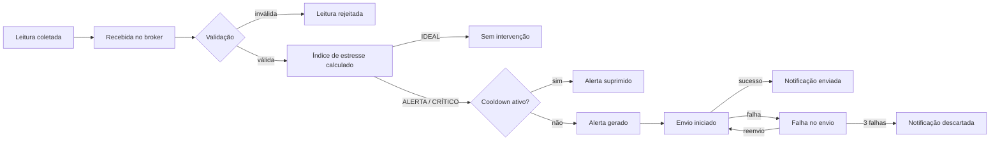
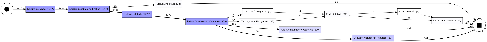
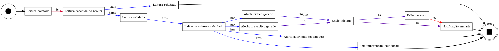
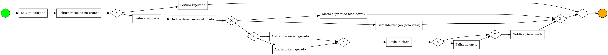

# 5. Análise de Processo e Demonstração Final

## 5.1 Por que mineração de processos

Um diagrama mostra como o processo **deveria** funcionar. A mineração de processos mostra como
ele **realmente** funcionou, a partir dos registros que o próprio sistema gera.
Cada leitura de sensor é um **caso**, e cada passo que ela atravessa (coleta, recebimento,
validação, decisão, notificação) é um **evento** com horário e responsável.

A plataforma grava esses eventos sozinha, na tabela `event_log` do PostgreSQL, e os exporta no
formato padrão de mineração de processos (*case id*, *activity*, *timestamp*, *resource*):

```
GET http://localhost:8000/api/event-log.csv
docker compose --profile analise run --rm process-mining     # roda a análise (pm4py)
```

## 5.2 Exemplo de event log

Trecho real do log (arquivo completo: `process_mining/saida/event_log.csv` e `.xes`):

| case_id | activity | timestamp (UTC) | resource |
|---|---|---|---|
| TINKER-TALHAO-01-11242155-00054 | Leitura coletada | 21:58:31.809 | TINKER-TALHAO-01 |
| TINKER-TALHAO-01-11242155-00054 | Leitura recebida no broker | 21:58:31.810 | kafka |
| TINKER-TALHAO-01-11242155-00054 | Leitura validada | 21:58:31.811 | motor |
| TINKER-TALHAO-01-11242155-00054 | Índice de estresse calculado | 21:58:31.812 | motor |
| TINKER-TALHAO-01-11242155-00054 | Alerta crítico gerado | 21:58:31.813 | motor |
| TINKER-TALHAO-01-11242155-00054 | Envio iniciado | 21:58:32.321 | gateway-whatsapp |
| TINKER-TALHAO-01-11242155-00054 | Falha no envio | 21:58:34.753 | gateway-whatsapp |
| TINKER-TALHAO-01-11242155-00054 | Notificação enviada | 21:58:40.328 | gateway-whatsapp |

Atividades registradas: Leitura coletada · Leitura recebida no broker · Leitura validada ·
Leitura rejeitada · Índice de estresse calculado · Sem intervenção (solo ideal) · Alerta suprimido
(cooldown) · Alerta preventivo gerado · Alerta crítico gerado · Envio iniciado · Falha no envio ·
Notificação enviada · Notificação descartada. O processo de **sanidade** (R1–R6) também é registrado,
com casos próprios (`SAN-…`).

## 5.3 Representação do processo

**Modelo esperado (como foi desenhado):**



**Processo descoberto a partir dos dados.** Mapa de frequência (quantos casos passaram por cada caminho):



**Mapa de desempenho** (tempo médio entre as atividades; as setas vermelhas são as mais lentas):



**Modelo BPMN descoberto automaticamente (Inductive Miner):**



## 5.4 Análise do fluxo

**Base analisada:** 1.317 casos (leituras), 6.588 eventos e 12 atividades em 13,2 minutos de
operação contínua, o equivalente a ~2 dias simulados de campo com 5 talhões. Também foram registrados
31 casos do processo de sanidade.

### Variações (variantes do processo)

| # | Caminho | Casos | % |
|---|---|---|---|
| 1 | coleta → validação → índice → **sem intervenção** (solo ideal) | 741 | 56,3% |
| 2 | coleta → validação → índice → **alerta suprimido** (cooldown) | 499 | 37,9% |
| 3 | coleta → **leitura rejeitada** (dado inválido) | 38 | 2,9% |
| 4 | … → **alerta preventivo** → envio → notificação enviada | 32 | 2,4% |
| 5 | … → **alerta crítico** → envio → notificação enviada | 6 | 0,5% |
| 6 | … → alerta preventivo → envio → **falha → reenvio** → enviada | 1 | 0,1% |

O processo tem **6 variantes**, todas previstas no modelo esperado. Nenhum caminho "proibido"
apareceu: não houve alerta sem validação nem notificação sem alerta. Isso confirma a
**conformidade** do processo real com o desenhado.

### Gargalos

| Transição | Média | Mediana | p95 | Tempo total acumulado |
|---|---|---|---|---|
| **Leitura coletada → recebida no broker** | 3,1 s | 1 ms | **27,0 s** | **68,0 min** |
| Envio iniciado → notificação enviada | 1,3 s | 842 ms | 4,6 s | 50,7 s |
| Recebida no broker → validada | 38 ms | 30 ms | 131 ms | 49,2 s |
| Alerta preventivo gerado → envio iniciado (fila) | 1,1 s | 512 ms | 5,4 s | 36,1 s |
| Validada → índice calculado | 1 ms | 1 ms | 1 ms | 1,3 s |

- **Ponta a ponta (coleta → produtor notificado):** mediana **1,7 s**, mas p95 de **44,2 s**.
- **10,8% das leituras chegaram atrasadas** (> 10 s), com atraso médio de 26,7 s: são as leituras
  guardadas em buffer enquanto o nó IoT estava sem conexão.

## 5.5 Insights

1. **O gargalo não está no software, está no campo.** O processamento interno (validação,
   cálculo e decisão) leva milissegundos. A transição *coleta → broker* acumula **68 minutos**
   de espera somados, quase todos causados pelas quedas de conexão dos nós IoT. A mediana é 1 ms,
   mas o p95 é 27 s: a maioria das leituras é instantânea e uma minoria espera muito.
   É um gargalo de **cauda**, que a média sozinha esconde.
2. **A diferença entre mediana e p95 do ponta a ponta (1,7 s × 44,2 s) vem da mesma causa:**
   um alerta crítico de um talhão que estava offline só chega ao produtor quando o sinal volta.
3. **O cooldown é a decisão de design de maior impacto:** 499 de 538 situações de estresse
   (**93%**) seriam mensagens repetidas para o mesmo talhão. Sem o cooldown, o notificador teria
   ~13× mais mensagens e o produtor sofreria fadiga de alerta.
4. **Qualidade de dado:** 2,9% das leituras foram rejeitadas. Durante os testes, a análise
   revelou leituras de **−1 °C** (falha de sensor) que passavam na validação por faixa e zeravam
   o índice de estresse. Por isso foi criada a **verificação de plausibilidade** (salto > 8 °C entre
   leituras seguidas = rejeitado).
5. **A saída é estável:** a fila de notificação teve p95 de 5,1 s e nenhuma notificação foi
   descartada. A única falha de gateway foi resolvida pelo reenvio automático.

## 5.6 Oportunidades de melhoria (priorizadas pelo impacto medido)

| # | Problema observado | Melhoria proposta | Impacto esperado |
|---|---|---|---|
| 1 | 10,8% das leituras atrasam ~27 s por nó offline (maior tempo acumulado) | **Gateway de borda** (edge/LoRaWAN) no campo, que aplica a R7 localmente mesmo sem internet e aciona a irrigação na hora | Elimina a cauda do p95 ponta a ponta |
| 2 | 93% das situações de estresse viram alertas suprimidos (episódios longos) | Evoluir o cooldown para **resumo periódico por fazenda** e **acionamento automático da irrigação** | Menos mensagens e ação sem intervenção humana |
| 3 | Espera na fila de notificação com p95 de 5,1 s em picos | **Workers paralelos por canal** e fila com **prioridade** (CRÍTICO na frente) | Alerta crítico nunca espera atrás de e-mail |
| 4 | 2,9% de leituras rejeitadas | **Ordem de serviço automática** quando um nó acumula rejeições seguidas | Menos pontos cegos no campo |
| 5 | Falhas de gateway exigem reenvio | **Fallback de canal** (WhatsApp → SMS → e-mail) + confirmação de leitura | Zero notificações perdidas |

> Relatório completo gerado automaticamente: `process_mining/saida/relatorio_processo.md`
> (variantes em `variantes.csv`, tempos em `transicoes.csv`, log em `event_log.csv`/`.xes`).

## 5.7 Demonstração final da plataforma

O vídeo final (5 a 8 min) percorre: arquitetura → `docker compose up` → dashboard ao vivo →
caso real de alerta crítico → Grafana → mineração de processos → pipeline DevSecOps.
O link está em `ENTREGA_LINKS.txt`.
