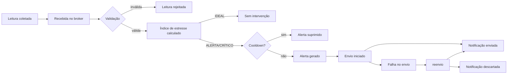
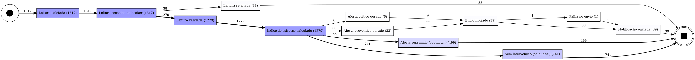
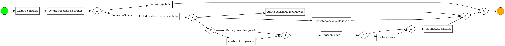

# Análise de Processo — AgroSmart (mineração de processos)

_Gerado em 24/11/2026 22:16 a partir do event log da plataforma._

## 1. Escopo do log

| Indicador | Valor |
|---|---|
| Processo analisado | Telemetria IoT → decisão → notificação |
| Casos (leituras) | 1.317 |
| Eventos | 6.588 |
| Atividades distintas | 12 |
| Variantes | 6 |
| Janela observada | 24/11 22:02:58 → 24/11 22:16:08 UTC (13,2 min) |
| Casos do processo de sanidade (R1–R6) | 31 |

## 2. Representação do processo

**Mapa de frequência (DFG)**

**Mapa de desempenho — tempo médio entre atividades**

**Modelo BPMN descoberto (Inductive Miner)**

## 3. Variantes (variações do fluxo)

| # | Casos | % | Duração média | Sequência |
|---|---|---|---|---|
| 1 | 741 | 56,3% | 3,3 s | Leitura coletada → Leitura recebida no broker → Leitura validada → Índice de estresse calculado → Sem intervenção (solo ideal) |
| 2 | 499 | 37,9% | 2,8 s | Leitura coletada → Leitura recebida no broker → Leitura validada → Índice de estresse calculado → Alerta suprimido (cooldown) |
| 3 | 38 | 2,9% | 1,5 s | Leitura coletada → Leitura recebida no broker → Leitura rejeitada |
| 4 | 32 | 2,4% | 8,6 s | Leitura coletada → Leitura recebida no broker → Leitura validada → Índice de estresse calculado → Alerta preventivo gerado → Envio iniciado → Notificação enviada |
| 5 | 6 | 0,5% | 7,3 s | Leitura coletada → Leitura recebida no broker → Leitura validada → Índice de estresse calculado → Alerta crítico gerado → Envio iniciado → Notificação enviada |
| 6 | 1 | 0,1% | 4,9 s | Leitura coletada → Leitura recebida no broker → Leitura validada → Índice de estresse calculado → Alerta preventivo gerado → Envio iniciado → Falha no envio → Notificação enviada |

| Desfecho | Casos | % |
|---|---|---|
| Solo ideal — sem intervenção | 741 | 56,3% |
| Alerta gerado e notificado | 39 | 3,0% |
| Alerta suprimido por cooldown | 499 | 37,9% |
| Leitura rejeitada (dado inválido) | 38 | 2,9% |

## 4. Desempenho e gargalos

| De → Para | Ocorrências | Média | Mediana | p95 | Tempo total acumulado |
|---|---|---|---|---|---|
| Leitura coletada → Leitura recebida no broker | 1.317 | 3,1 s | 1 ms | 27,0 s | 68,0 min |
| Envio iniciado → Notificação enviada | 38 | 1,3 s | 842 ms | 4,6 s | 50,7 s |
| Leitura recebida no broker → Leitura validada | 1.279 | 38 ms | 30 ms | 131 ms | 49,2 s |
| Alerta preventivo gerado → Envio iniciado | 33 | 1,1 s | 512 ms | 5,4 s | 36,1 s |
| Alerta crítico gerado → Envio iniciado | 6 | 764 ms | 516 ms | 1,4 s | 4,6 s |
| Falha no envio → Notificação enviada | 1 | 3,8 s | 3,8 s | 3,8 s | 3,8 s |
| Leitura recebida no broker → Leitura rejeitada | 38 | 35 ms | 27 ms | 110 ms | 1,3 s |
| Leitura validada → Índice de estresse calculado | 1.279 | 1 ms | 1 ms | 1 ms | 1,3 s |

- **Ponta a ponta (coleta → produtor notificado):** mediana 1,7 s, p95 44,2 s, máximo 52,5 s (39 casos).
- **Espera na fila de notificação:** mediana 512 ms, p95 5,1 s, máximo 7,6 s.
- **Leituras entregues com atraso (> 10 s, buffer offline):** 142 (10,8%), atraso médio 26,7 s.
- **Retrabalho no envio:** 1 casos tiveram ao menos uma falha de envio; 0 notificações foram descartadas após todas as tentativas.

## 5. Insights

1. **Principal gargalo (maior tempo acumulado):** `Leitura coletada → Leitura recebida no broker` — média 3,1 s, p95 27,0 s. 
2. **Transição mais lenta por caso:** `Falha no envio → Notificação enviada` (média 3,8 s).
3. **O processamento interno é praticamente instantâneo:** validação, cálculo do índice e decisão levam milissegundos. Todo o tempo relevante está nas bordas do processo — conectividade no campo (entrada) e gateways de mensagem (saída).
4. **Variação de entrada:** 2,9% das leituras são rejeitadas por dado inválido e 10,8% chegam atrasadas por queda de conexão do nó IoT.
5. **O cooldown evita 93% das mensagens** que seriam enviadas — sem ele, a fila do notificador seria várias vezes maior.

## 6. Oportunidades de melhoria

_Ordenadas pelo impacto medido neste log._

| # | Problema observado (dado do log) | Melhoria proposta | Impacto esperado |
|---|---|---|---|
| 1 | 10,8% das leituras chegam com atraso médio de 26,7 s (nó IoT offline) | Gateway de borda (edge/LoRaWAN) no campo que decide localmente R7 mesmo sem internet; alerta operacional de nó offline (já no Grafana) | Elimina o maior tempo acumulado do processo |
| 2 | 93% dos alertas R7 suprimidos pelo cooldown (episódios longos de estresse) | Evoluir de cooldown para resumo periódico por fazenda (digest) + acionamento automático da irrigação | Menos fadiga de alerta e ação sem intervenção humana |
| 3 | Espera na fila de notificação com p95 de 5,1 s | Workers paralelos por canal e fila com prioridade (CRÍTICO na frente) | Reduz o tempo até o produtor agir |
| 4 | 2,9% das leituras rejeitadas por dado inválido | Regra de manutenção: N rejeições seguidas do mesmo nó abrem ordem de serviço para trocar/calibrar o sensor | Menos dados perdidos e menos pontos cegos |
| 5 | 1 casos com falha de envio, 0 descartados | Fallback automático de canal (WhatsApp → SMS → e-mail) e confirmação de leitura | Zera notificações perdidas |
