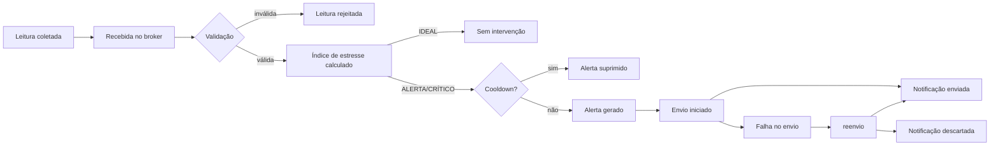
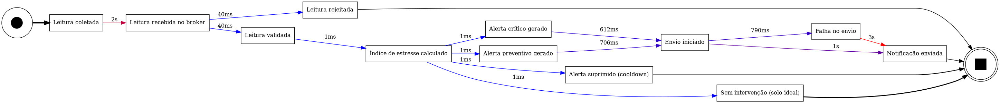

# Análise de Processo — AgroSmart (mineração de processos)

_Gerado em 25/11/2026 00:11 a partir do event log da plataforma._

## 1. Escopo do log

| Indicador | Valor |
|---|---|
| Processo analisado | Telemetria IoT → decisão → notificação |
| Casos (leituras) | 1.908 |
| Eventos | 9.510 |
| Atividades distintas | 12 |
| Variantes | 6 |
| Janela observada | 24/11 23:52:30 → 25/11 00:11:34 UTC (19,1 min) |
| Casos do processo de sanidade (R1–R6) | 32 |

## 2. Representação do processo

**Mapa de frequência (DFG)**

**Mapa de desempenho — tempo médio entre atividades**

**Modelo BPMN descoberto (Inductive Miner)**

## 3. Variantes (variações do fluxo)

| # | Casos | % | Duração média | Sequência |
|---|---|---|---|---|
| 1 | 1171 | 61,4% | 2,3 s | Leitura coletada → Leitura recebida no broker → Leitura validada → Índice de estresse calculado → Sem intervenção (solo ideal) |
| 2 | 614 | 32,2% | 3,2 s | Leitura coletada → Leitura recebida no broker → Leitura validada → Índice de estresse calculado → Alerta suprimido (cooldown) |
| 3 | 70 | 3,7% | 3,6 s | Leitura coletada → Leitura recebida no broker → Leitura rejeitada |
| 4 | 39 | 2,0% | 10,3 s | Leitura coletada → Leitura recebida no broker → Leitura validada → Índice de estresse calculado → Alerta preventivo gerado → Envio iniciado → Notificação enviada |
| 5 | 10 | 0,5% | 5,4 s | Leitura coletada → Leitura recebida no broker → Leitura validada → Índice de estresse calculado → Alerta crítico gerado → Envio iniciado → Notificação enviada |
| 6 | 4 | 0,2% | 13,9 s | Leitura coletada → Leitura recebida no broker → Leitura validada → Índice de estresse calculado → Alerta preventivo gerado → Envio iniciado → Falha no envio → Notificação enviada |

| Desfecho | Casos | % |
|---|---|---|
| Solo ideal — sem intervenção | 1.171 | 61,4% |
| Alerta gerado e notificado | 53 | 2,8% |
| Alerta suprimido por cooldown | 614 | 32,2% |
| Leitura rejeitada (dado inválido) | 70 | 3,7% |

## 4. Desempenho e gargalos

| De → Para | Ocorrências | Média | Mediana | p95 | Tempo total acumulado |
|---|---|---|---|---|---|
| Leitura coletada → Leitura recebida no broker | 1.908 | 2,7 s | 1 ms | 24,0 s | 86,0 min |
| Leitura recebida no broker → Leitura validada | 1.838 | 41 ms | 30 ms | 141 ms | 74,6 s |
| Envio iniciado → Notificação enviada | 49 | 1,3 s | 826 ms | 3,9 s | 65,1 s |
| Alerta preventivo gerado → Envio iniciado | 43 | 706 ms | 510 ms | 1,5 s | 30,4 s |
| Falha no envio → Notificação enviada | 4 | 3,6 s | 3,6 s | 3,6 s | 14,2 s |
| Alerta crítico gerado → Envio iniciado | 10 | 613 ms | 512 ms | 1,1 s | 6,1 s |
| Envio iniciado → Falha no envio | 4 | 790 ms | 893 ms | 981 ms | 3,2 s |
| Leitura recebida no broker → Leitura rejeitada | 70 | 41 ms | 28 ms | 110 ms | 2,8 s |

- **Ponta a ponta (coleta → produtor notificado):** mediana 2,0 s, p95 45,9 s, máximo 52,9 s (53 casos).
- **Espera na fila de notificação:** mediana 511 ms, p95 1,5 s, máximo 8,0 s.
- **Leituras entregues com atraso (> 10 s, buffer offline):** 187 (9,8%), atraso médio 25,5 s.
- **Retrabalho no envio:** 4 casos tiveram ao menos uma falha de envio; 0 notificações foram descartadas após todas as tentativas.

## 5. Insights

1. **Principal gargalo (maior tempo acumulado):** `Leitura coletada → Leitura recebida no broker` — média 2,7 s, p95 24,0 s. 
2. **Transição mais lenta por caso:** `Falha no envio → Notificação enviada` (média 3,6 s).
3. **O processamento interno é praticamente instantâneo:** validação, cálculo do índice e decisão levam milissegundos. Todo o tempo relevante está nas bordas do processo — conectividade no campo (entrada) e gateways de mensagem (saída).
4. **Variação de entrada:** 3,7% das leituras são rejeitadas por dado inválido e 9,8% chegam atrasadas por queda de conexão do nó IoT.
5. **O cooldown evita 92% das mensagens** que seriam enviadas — sem ele, a fila do notificador seria várias vezes maior.

## 6. Oportunidades de melhoria

_Ordenadas pelo impacto medido neste log._

| # | Problema observado (dado do log) | Melhoria proposta | Impacto esperado |
|---|---|---|---|
| 1 | 9,8% das leituras chegam com atraso médio de 25,5 s (nó IoT offline) | Gateway de borda (edge/LoRaWAN) no campo que decide localmente R7 mesmo sem internet; alerta operacional de nó offline (já no Grafana) | Elimina o maior tempo acumulado do processo |
| 2 | 92% dos alertas R7 suprimidos pelo cooldown (episódios longos de estresse) | Evoluir de cooldown para resumo periódico por fazenda (digest) + acionamento automático da irrigação | Menos fadiga de alerta e ação sem intervenção humana |
| 3 | 4 casos com falha de envio, 0 descartados | Fallback automático de canal (WhatsApp → SMS → e-mail) e confirmação de leitura | Zera notificações perdidas |
| 4 | 3,7% das leituras rejeitadas por dado inválido | Regra de manutenção: N rejeições seguidas do mesmo nó abrem ordem de serviço para trocar/calibrar o sensor | Menos dados perdidos e menos pontos cegos |
